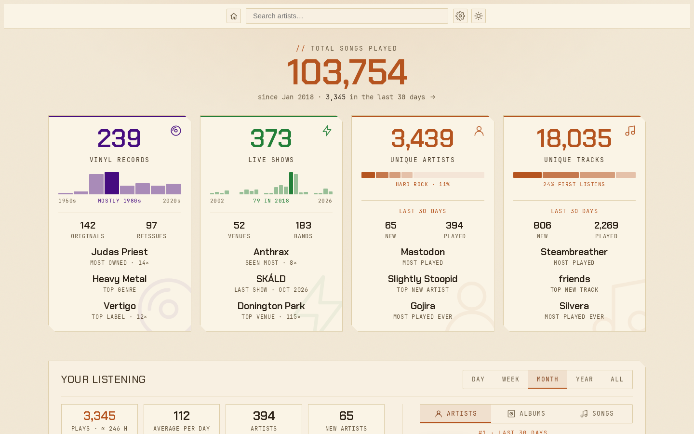
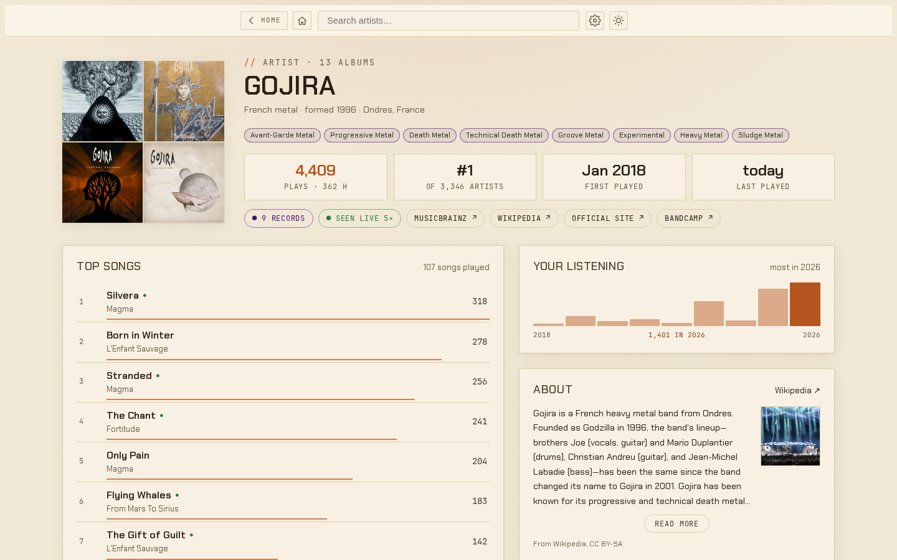
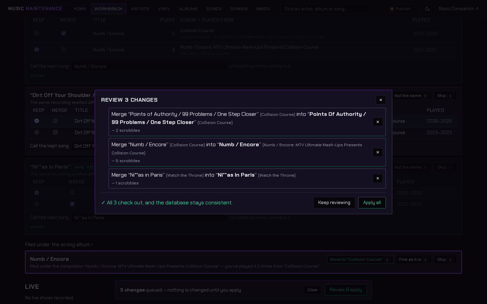
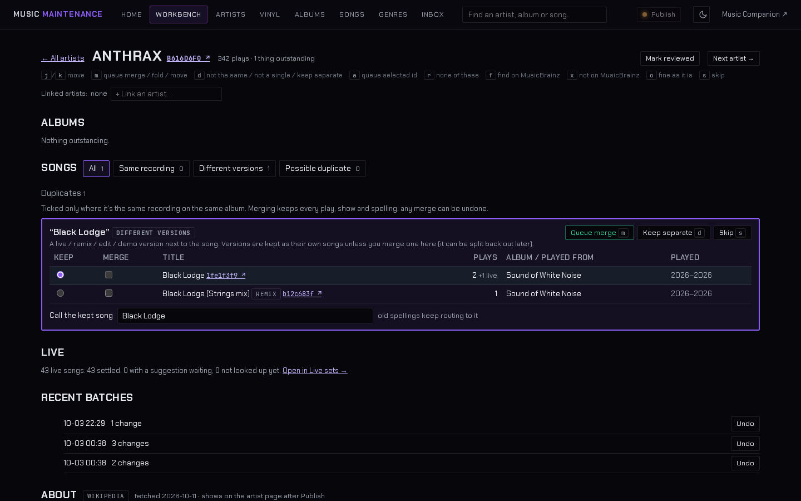
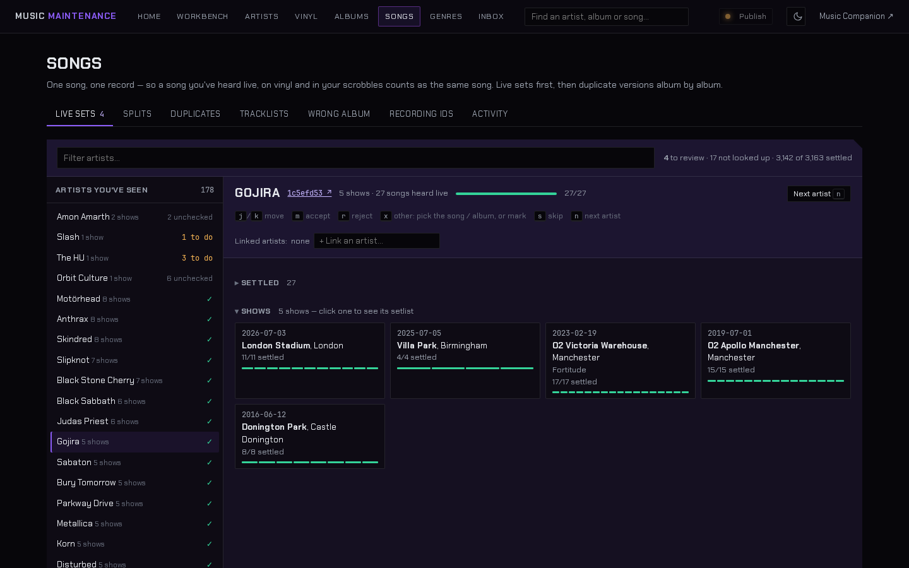
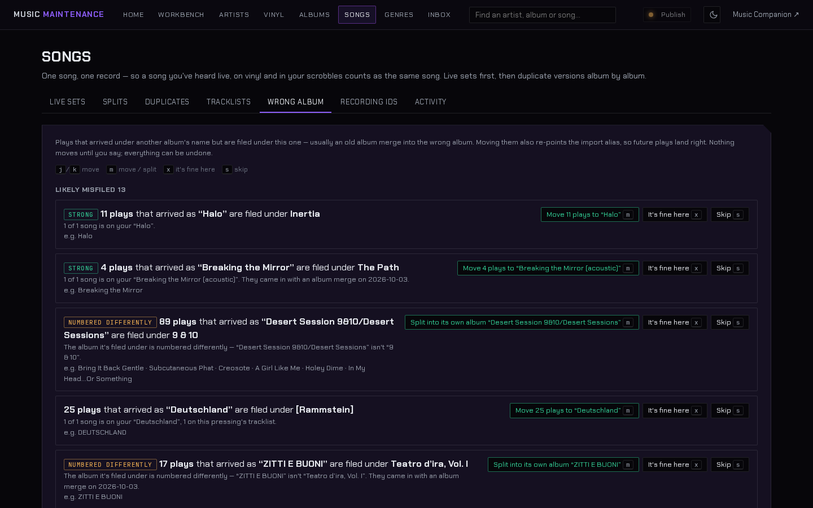
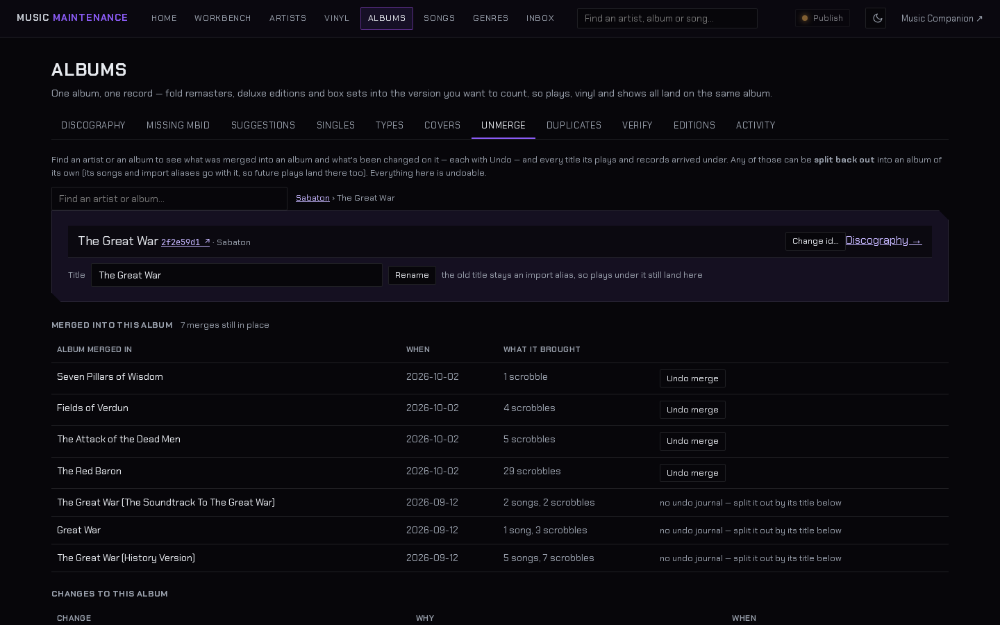
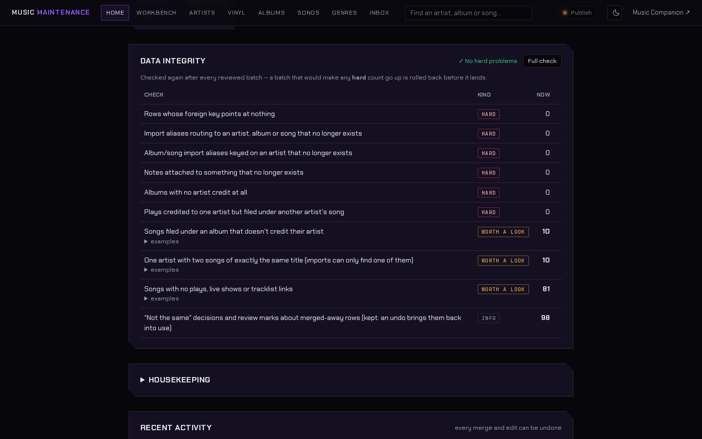

# Music Companion

An interactive archive of my obsession with music, linking together my record collection, my listening history and every gig I've been to.

**See it live:** [mjhadfield.github.io/music-companion](https://mjhadfield.github.io/music-companion/) (works on mobile too)

## Background

Music has been a big part of my life for as long as I can remember, and I've always been a stats junkie. I wanted one place where I could pick a song and see everything about it: whether I own it on vinyl, how many times I've played it, and every time I've seen it live, with the full setlist from each show. Basically an interactive rabbit hole.

It pulls from three places:

- **Physical** - my vinyl collection, from Discogs
- **Digital** - around 100k scrobbles from Last.fm (only back to 2018, everything before that is lost to time)
- **Live** - every gig I've been to, with setlists from Setlist.fm

The hard part is that the data is a mess. "Remastered" vs "Deluxe Edition" vs "40th Anniversary Edition", live versions, singles that pretend to be albums, bands spelt three different ways... MusicBrainz IDs tie everything back together, so the same song from Discogs, Last.fm and Setlist.fm ends up as one row.

## How it works

It's all one SQLite database. The site is plain HTML/JS with no backend: it downloads a slimmed-down copy of the database and queries it in the browser with [sql.js](https://sql.js.org/), so it can live on GitHub Pages for free.

Behind that is a maintenance tool that runs at home. It pulls in new data, looks up missing IDs and finds duplicates, then puts everything in a list for me to review before anything is saved. I started out doing this by hand with SQL inserts, which was a complete nightmare.

## The maintenance tool

The front end is the fun bit to look at, but honestly the maintenance tool is where most of the work has gone. The database currently holds around 3,400 artists, 7,600 albums, 18,000 songs and 104,000 plays, and every new import brings in a fresh batch of near-duplicates. Fixing that one row at a time was never going to work, so I built a set of tools to merge, split and clean the data in bulk without losing track of anything.

As of 28/10/2026 that's been around 940 album merges, 880 song merges, 13,000 smaller edits and 5,000 old spellings kept as aliases, spread over nearly 500 reviewed batches. Not bad for something I mostly do in the evenings.

A few rules it lives by:

- **Nothing changes without me clicking it.** MusicBrainz lookups only ever make suggestions. Only the safest ones come pre-ticked, everything else waits for me.
- **Everything can be undone.** Every merge and edit is journalled, so any of them can be rolled back at any point (I recently fixed a mistake from the first week of the project)
- **Old names are never thrown away.** When something gets merged or renamed, the old spelling sticks around as an alias, so the next import lands in the right place instead of quietly recreating the duplicate.
- **Live, remix and demo versions stay separate** unless I decide otherwise.

### The workbench

Most of the cleaning happens one artist at a time. The workbench pulls everything outstanding for an artist onto one page: albums to merge or identify, duplicate songs, songs filed under the wrong album, and anything MusicBrainz thinks looks off. It's keyboard driven, so I can blast through an artist pretty quickly.

Nothing is applied straight away. Changes queue up in a basket, and when I'm happy I get a dry run that tests every change against the real database and then throws the result away. If it all checks out, it goes in as one batch that can be undone in one go.

The same page handles the trickier calls, like a remix sitting next to the original. The same recording spelt two ways on the same album gets pre-ticked, different versions never do. If I do merge one by mistake, it can be split back out later with all its plays.

### Live sets

Setlist.fm only gives you song titles, so every song from every show has to be matched to the studio version in my library. Otherwise a song I've seen five times and played 300 times would show up as two different things. The tool looks each one up on MusicBrainz and suggests a match, then I accept or reject it. It also copes with covers, where it'll suggest the band's own recording if they've released one. Out of 3,163 live songs, 3,142 are settled.

### Plays on the wrong album

Old merges weren't always perfect, so this one goes looking for plays that arrived under one album's name but ended up filed under another. It sorts them by how sure it is, and it'll also spot the ones where the album is just numbered differently (Desert Sessions 9 & 10, I'm looking at you). Moving the plays also fixes the alias, so future plays land in the right place too.

### Undoing things

Every album keeps a full history of what's been merged into it and when. Sabaton's *The Great War* is a good example: the history edition, the soundtrack version, a misspelling and four singles have all been folded into the one album. Any of those can be undone, and the older ones (from before I had proper undo) can still be split back out by the title the plays arrived under.

### Integrity checks

With this much merging going on, I wanted a safety net. After every batch, the tool runs a set of checks for broken links, orphaned aliases, plays filed under the wrong artist and so on. If a batch would make any of the hard checks go up, it gets rolled back before it ever lands. The softer ones are just flagged as worth a look.

It also caches every MusicBrainz response (over 43,000 so far) and sticks to their one request per second limit, so I'm not hammering their servers every time I re-run a lookup.

## Can I run it?

Not really. It's built around my own data and hooked into my home setup ([Citadel](https://www.mikehadfield.co.uk/#/projects/citadel)), so it isn't designed to be picked up and run by anyone else. You're welcome to have a look at the code though.

There's a full write-up with screenshots on [my website](https://www.mikehadfield.co.uk/#/projects/music-companion).

## Credits

Data from [MusicBrainz](https://musicbrainz.org/), [Last.fm](https://www.last.fm/), [Setlist.fm](https://www.setlist.fm/), [Discogs](https://www.discogs.com/) and the [Cover Art Archive](https://coverartarchive.org/). Not affiliated with or endorsed by any of them.
